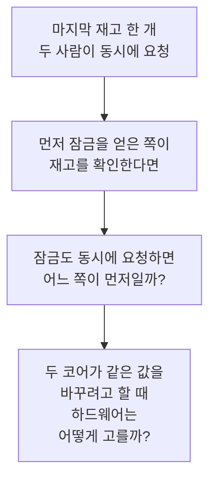
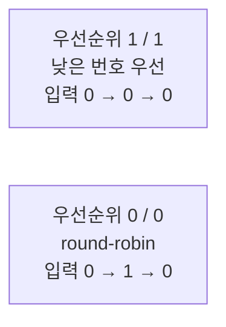
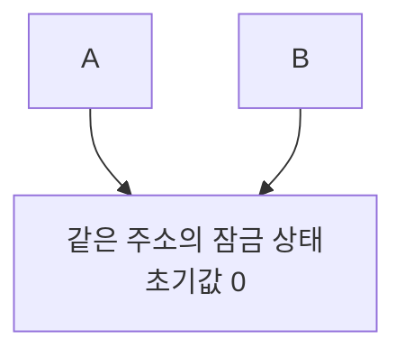
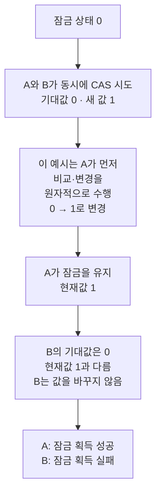

# 마지막 재고 한 개에서 CPU의 처리 순서까지

검수 전 초안 · 작성 2026-11-14 · 수정 2026-11-17

## 마지막 한 개는 누구에게 줄까

커머스 프로젝트에서 주문 요청을 어떻게 처리할지 검토하다가 마지막 재고 한 개를 두 사람이 동시에 구매하는 상황을 생각했다. 이 프로젝트에서는 고객이 구매하기에 진입하면 결제할 수량을 잠시 확보하기로 했다. 이를 재고 선점이라고 부르고 있다.

마지막 한 개를 두 사람에게 모두 줄 수는 없다. 한 사람만 선점에 성공해야 한다는 조건은 분명했다. 나는 그다음이 궁금했다.

> 두 사람이 정말 똑같은 시각에 구매 버튼을 눌렀다면, 시스템은 누구를 먼저 처리할까?

“먼저 잠금을 얻은 요청이 처리한다”는 설명을 들으면 다시 질문이 생겼다. **둘이 잠금도 동시에 요청했다면, 그중 하나가 먼저 얻는 과정은 무엇일까?**

이 질문을 따라가다 보니 주문 처리에서 DB 잠금으로, 다시 CPU와 하드웨어의 동작으로 내려가게 됐다.

## PID와 시간 정밀도에 대해 잘못 알고 있던 점

처음에는 CPU가 아주 짧은 시간 차이와 PID로 요청을 구분하므로, 실제로 동시에 처리되는 일은 거의 없다고 생각했다. CPU와 DB가 시간을 표현하는 정밀도가 달라서 같은 시각으로 기록되고, 그 때문에 중복 처리가 생기는 것으로 이해하고 있었다.

확인해 보니 PID는 **프로세스를 식별하는 번호**였다. Linux에서는 같은 프로세스의 스레드들이 PID를 공유한다. 번호가 있다고 실행이 한 줄로 정렬되는 것은 아니다. 여러 CPU 코어는 서로 다른 스레드를 동시에 실행할 수 있다. [Linux getpid(2)](https://man7.org/linux/man-pages/man2/getpid.2.html), [Oracle Processes and Threads](https://docs.oracle.com/javase/tutorial/essential/concurrency/procthread.html)

시간 기록도 따로 생각해야 했다. 로그에 같은 시각이 찍히는 것과 두 요청의 실행이 겹치는 것은 다른 문제다. 시계를 더 정밀하게 만들어도, 두 요청이 모두 재고를 확인한 뒤 각각 차감하는 일을 막아 주지는 않는다.

네트워크를 거치면서 도착 순서가 달라질 수 있다는 설명도 이해했다. 그래도 **같은 자원에 대한 요청이 실제로 겹쳤을 때, 내부에서는 어떻게 하나를 고르는지**까지 알고 싶었다.

## 동시에 요청해도 하나를 고르는 방법

하드웨어에는 여러 요청이 같은 자원을 사용하려 할 때 접근을 조정하는 **중재(arbitration)**가 있다. 요청 사이의 미세한 시간 차이를 찾아야만 선택할 수 있는 것은 아니다. 정해 둔 우선순위나 이전에 처리한 차례를 이용할 수도 있다.

구체적인 예로 AMD의 **FPGA용 AXI Interconnect** 문서를 확인했다. FPGA는 필요한 디지털 회로를 구성할 수 있는 반도체이고, 여기서 살펴본 Interconnect는 요청을 연결하고 중재하는 부품이다. 이 문서는 Ryzen CPU의 내부 동작을 설명하는 자료는 아니다. [AMD의 FPGA 설명](https://docs.amd.com/r/2023.2-English/ug1393-vitis-application-acceleration/Working-with-Alveo-Accelerator-Cards)

이 부품의 입력 연결부 두 개를 입력 0과 입력 1이라고 하자. 번호는 어느 연결부로 요청이 들어오는지를 구분한다. 먼저 도착한 고객에게 0번을 붙이는 방식과는 관계가 없다.

두 입력이 모두 처리 가능한 요청을 내는 경우, 다음과 같은 선택 규칙이 있다. [AMD Transaction Arbitration](https://docs.amd.com/r/en-US/pg059-axi-interconnect/Transaction-Arbitration)

| 설정 | 선택 방식 |
| --- | --- |
| 두 입력의 우선순위가 모두 1 | 같은 우선순위이므로 번호가 낮은 입력 0을 먼저 선택한다. |
| 두 입력의 우선순위가 모두 0 | round-robin으로 차례를 돌아가며 선택한다. |

그림은 매번 두 입력 모두 선택 가능한 상태이고, 앞서 선택한 요청이 수락된 뒤 다음 선택을 하는 경우다. round-robin의 첫 차례는 입력 0으로 가정했다. 실제 부품은 처리 한도에 걸린 요청을 선택 대상에서 제외할 수 있으므로, 이 그림을 모든 상황의 처리 순서로 볼 수는 없다.

여기서 번갈아 주는 것은 각 입력으로 들어온 요청이 처리될 기회다. 쇼핑몰이 이번 재고를 고객 A에게 주고 다음 재고를 고객 B에게 준다는 뜻은 아니다.

이 사례로 **동시에 들어온 요청도 정해진 규칙과 내부 상태에 따라 하나를 선택할 수 있다**는 점을 이해했다. Intel Core·AMD Ryzen·Apple M 시리즈가 실제로 어느 요청을 먼저 선택하는지는 이 문서로 알 수 없다.

## 잠금 값 0과 1의 뜻

순서를 고를 수 있다는 점을 이해하고 나니, 잠금 설명에 나온 0과 1이 헷갈렸다. A와 B가 각자 0을 가지고 시작하는 것일까? A에게 0번, B에게 1번을 붙이는 것일까?

앞에서 본 입력 번호와 잠금 값은 역할이 다르다. **잠금 값은 프로그램이 메모리에 기록해 둔 잠금의 현재 상태**다. 이번 예시에서는 아무도 잠금을 갖고 있지 않으면 0, 누군가 갖고 있으면 1이라고 정한다.

그림의 A와 B는 서로 다른 CPU 코어다. 두 코어가 비교할 대상은 같은 주소에 있는 잠금 상태다. 두 코어 모두 “현재 값이 0이면 1로 바꾸겠다”고 시도한다. A와 B가 각자 바꿀 잠금을 하나씩 가진 상황이 아니다.

0과 1은 이 예시에서 정한 표현이다. 실제 잠금이 모두 두 값만 쓰는 것은 아니며, 1이라는 값만으로 보유자가 A인지 B인지 알 수도 없다.

### 둘 다 처음에 0을 읽었다면

일반적인 읽기로 확인했다면 두 코어가 모두 0을 봤을 수 있다. 그 값을 믿고 각각 1을 쓰면 둘 다 잠금을 얻었다고 생각할 수 있다. 따라서 **실제로 잠금을 얻으려는 순간의 비교와 변경이 함께 이루어져야 한다.**

CAS(Compare-and-Swap)는 대상 값이 기대값과 같을 때만 새 값을 저장하는 **원자적 연산**이다. 원자적이라는 말은 같은 값에 대한 다른 변경이 비교와 변경 사이에 끼어들지 못한다는 뜻이다. [Microsoft InterlockedCompareExchange](https://learn.microsoft.com/en-us/windows/win32/api/winnt/nf-winnt-interlockedcompareexchange)

A가 0을 1로 바꾼 뒤 잠금을 유지하고 있다면 B의 CAS는 1을 확인한다. B가 전에 0을 읽었더라도, 그때의 값만으로 잠금 획득에 성공할 수는 없다.

하드웨어 중재와 CAS도 구분할 수 있었다. 중재는 경합한 접근의 처리 기회를 조정하고, CAS는 비교와 조건부 변경을 원자적으로 수행한다. **CAS 자체가 번호순이나 round-robin으로 승자를 고르는 것은 아니다.**

Intel의 Xeon 관련 자료는 캐시된 메모리의 잠긴 연산에서 캐시 일관성 메커니즘으로 원자적 실행을 보장하는 경우를 설명한다. 항상 메모리 버스 전체를 잠그는 것은 아니다. 다만 이 자료로 특정 실행에서 A가 먼저 선택된 정확한 이유까지 알 수는 없다. [Intel 캐시 일관성과 원자적 실행](https://www.intel.com/content/www/us/en/support/articles/000099741/processors/intel-xeon-processors.html)

이 예시는 잠금을 얻는 원리를 설명한 것이다. 실제 잠금 구현에는 해제, 실패한 요청의 대기·재시도, 메모리 접근 순서에 대한 처리도 필요하다.

## 잠금 해제와 재고 반환은 별개의 처리다

잠금과 재고 선점도 구분해야 했다. 잠금은 재고를 확인하고 바꾸는 동안 다른 요청이 함께 변경하지 못하게 하는 데 사용한다. 재고 선점은 고객에게 판매할 수량을 확보하는 처리다.

아래는 A가 선점 기록까지 정상적으로 저장한 경우의 예시다. 잠금 값과 재고 수량의 차이를 보여주는 표이며, 실제 DB의 잠금 구현을 나타낸 것은 아니다.

| 진행 상황 | 잠금 값 | 판매 가능 재고 |
| --- | --- | --- |
| 시작 | 0 · 아무도 보유하지 않음 | 1개 |
| A가 잠금을 얻음 | 1 · A가 보유 | 1개 |
| A가 재고 한 개를 선점하고 기록함 | 1 · A가 보유 | 0개 |
| A가 처리를 마치고 잠금을 해제함 | 0 · 아무도 보유하지 않음 | 0개 |
| B가 다시 시도해 잠금을 얻음 | 1 · B가 보유 | 0개 |
| B가 품절을 확인하고 잠금을 해제함 | 0 · 아무도 보유하지 않음 | 0개 |

**잠금 값이 다시 0이 되어도 판매 가능 재고가 한 개로 돌아오지는 않는다.** B가 잠금을 얻었다면 재고를 확인할 수 있지만, A가 확보한 수량을 다시 선점할 수는 없다. 선점한 재고를 언제 반환할지는 별도의 주문·결제 정책에 따른다.

B가 다음에 잠금을 얻는 것은 이 표에서 가정한 진행 순서다. CAS 실패가 자동 재시도나 B의 다음 차례까지 보장하지는 않는다.

## 커피챗에서 들은 주문과 예매 이야기

주말 커피챗에서는 주문에서 이런 일이 거의 없고, 예매에서는 생길 수 있다는 의견을 들었다. 이 말을 계기로 어떤 재고를 두고 경쟁하는지 다시 생각했다.

| 상황 | 수량을 기준으로 보면 |
| --- | --- |
| 같은 상품이 100개이고, 두 사람이 각각 한 개를 구매 | 두 사람 모두 구매할 수 있다. |
| 마지막 상품 한 개를 두 사람이 구매 | 한 사람만 확보할 수 있다. |
| 같은 공연·회차의 A열 12번 좌석을 두 사람이 예매 | 다른 좌석이 남아 있어도 그 좌석은 한 사람만 확보할 수 있다. |

지정 좌석은 좌석마다 수량이 한 개인 셈이다. 상품 주문도 한정 판매나 마지막 재고에서는 같은 문제가 생길 수 있다. 재고가 충분할 때도 각 주문의 수량 변경이 빠짐없이 반영돼야 한다.

배민 선물하기의 공개 사례에서도 **상품권 초과 판매 방지와 재고 증감의 동시성 처리**를 요구사항으로 다뤘다. 구매 시스템에서도 검토하는 문제라는 점은 확인할 수 있었다. 다만 이 사례는 주문과 예매 중 어느 쪽에서 문제가 더 자주 생기는지 비교한 자료는 아니다. 커피챗의 의견도 모든 주문 서비스에 적용되는 사실로 받아들이지는 않았다. [우아한형제들 기술블로그, 2021-01-19](https://techblog.woowahan.com/2709/)

## 다시 주문 설계로 돌아와서

동시에 요청해도 한쪽을 먼저 처리할 수 있다는 점은 이해했다. 고객이 버튼을 누른 순서를 어떻게 지킬지는 별도의 설계 문제로 남았다. 고객에게 선착순을 약속하려면 어떤 지점에서 접수 순서를 정할지 따로 설계해야 한다. 다만 초과 판매를 막는 데 선착순 대기열이나 추첨이 필수인 것은 아니다.

애플리케이션에서 하드웨어의 선택 규칙을 직접 구현할 필요는 없다. 대신 DB가 제공하는 기능으로 재고 확인·수량 변경·선점 기록을 안전하게 묶어야 한다.

예를 들어 MySQL InnoDB에서는 명시적으로 시작한 트랜잭션 안에서 `SELECT ... FOR UPDATE`로 재고를 읽고, 그 뒤 수량을 변경하는 방법을 검토할 수 있다. 잠금은 검색 중 만나는 인덱스 레코드와 검색 조건 등의 영향을 받고, 트랜잭션이 커밋되거나 롤백될 때 해제된다. 충돌하는 잠금 요청은 대기할 수 있지만, 일반적인 일관 읽기까지 모두 막는 것은 아니다. [MySQL 8.4 Locking Reads](https://dev.mysql.com/doc/refman/8.4/en/innodb-locking-reads.html)

잠금을 먼저 얻어도 트랜잭션이 롤백되면 선점에 성공한 것이 아니다. 고객에게 언제 성공을 알릴지는 저장 결과와 함께 정해야 한다. 앞서 정한 구매하기 진입 시 선점 정책과, 결제 결과를 모르는 동안에는 시간이 지났다는 이유만으로 선점을 반환하지 않는 조건은 유지한다.

다음에는 **재고 확인·수량 변경·선점 기록을 어디까지 하나의 트랜잭션으로 묶을지** 정하고, 아래 상황을 시험하려고 한다.

- 마지막 한 개에 두 요청이 겹쳐도 성공한 선점 수량이 한 개를 넘지 않는가?
- 재고가 음수가 되지 않고, 수량과 선점 기록이 서로 맞는가?
- 한 요청이 처리 도중 실패하면, 롤백 후 다른 요청이 남은 재고를 선점할 수 있는가?

고객 우선순위 정책이 없는 시험에서 A가 항상 이기는 것을 기대하지는 않는다. 이번에 확인한 것은 동시에 들어온 요청에 순서가 생길 수 있는 원리다. MySQL과 구체적인 DB 잠금 방식은 아직 검토 대상이며, 재고 선점 코드·DB 동시성 시험·CPU 내부 동작의 실측은 하지 않았다.

프로젝트의 다음 검토는 [F04 재고 선점 요구사항](../02-requirements.md)과 이어진다.

## 참고 자료

아래 자료의 본문은 2026-11-17에 확인했다. 발행·갱신일은 각 문서의 표기다.

| 자료 | 발행·갱신일 | 확인한 내용 |
| --- | --- | --- |
| [Linux getpid(2)](https://man7.org/linux/man-pages/man2/getpid.2.html) | 2026-02-08 | PID의 의미와 같은 프로세스의 스레드가 PID를 공유한다는 설명. |
| [Oracle Processes and Threads](https://docs.oracle.com/javase/tutorial/essential/concurrency/procthread.html) | 미표기 · JDK 8 튜토리얼 | 프로세스·스레드와 여러 코어의 동시 실행. 현재 JDK 설정의 근거로 사용하지 않았다. |
| [AMD의 FPGA 설명](https://docs.amd.com/r/2023.2-English/ug1393-vitis-application-acceleration/Working-with-Alveo-Accelerator-Cards) | 2023-12-13 · UG1393 2023.2 | FPGA의 논리 요소와 연결을 구성할 수 있다는 설명. |
| [AMD Transaction Arbitration](https://docs.amd.com/r/en-US/pg059-axi-interconnect/Transaction-Arbitration) | 2025-12-19 · PG059 2.1 | FPGA용 AXI Interconnect의 우선순위·입력 번호·round-robin. |
| [Microsoft InterlockedCompareExchange](https://learn.microsoft.com/en-us/windows/win32/api/winnt/nf-winnt-interlockedcompareexchange) | 2022-05-24 | 비교·조건부 교환의 원자성. |
| [Intel 캐시 일관성과 원자적 실행](https://www.intel.com/content/www/us/en/support/articles/000099741/processors/intel-xeon-processors.html) | 최종 검토 2026-07-08 | 캐시된 메모리의 잠긴 연산을 다룬 Xeon 관련 설명. |
| [MySQL 8.4 Locking Reads](https://dev.mysql.com/doc/refman/8.4/en/innodb-locking-reads.html) | 미표기 | 잠금 읽기, 트랜잭션 조건, 커밋·롤백 시 해제. |
| [선물하기 시스템의 상품 재고는 어떻게 관리되어질까?](https://techblog.woowahan.com/2709/) | 2021-01-19 | 상품권 구매에서 초과 판매와 재고 변경의 동시성을 다룬 사례. |
