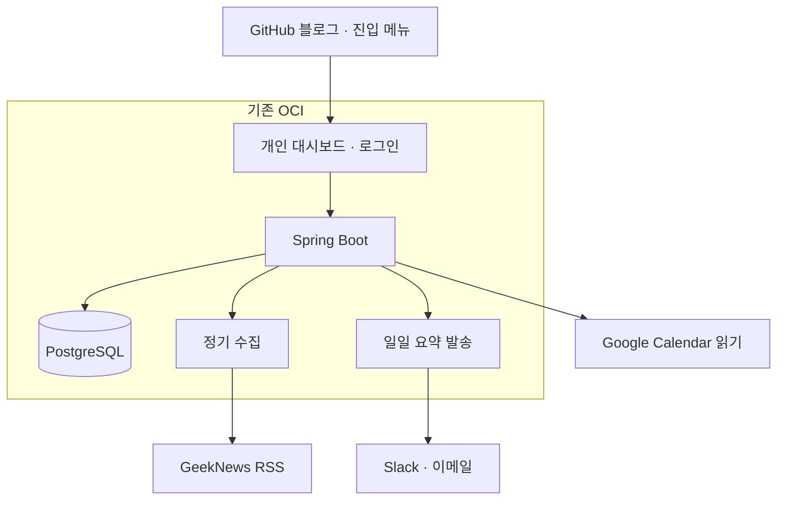

# DevDesk 0.1

개발 소식과 오늘 일정을 가까이 두기 위한 개인 도구. 운영은 기존 OCI 한 대, 프론트는 기존 블로그에서 진입한다. 개인 데이터가 오가는 화면은 백엔드와 같은 출처에서 제공한다.

## 현재 범위

- 공식 GeekNews RSS/Atom 수집, DB 중복 방지, 수집 실패 시 이전 데이터 유지.
- 목록·검색·관심 있음·관심 없는 주제·이미 앎·나중에 읽기·읽음. 현재 반응과 반응 이력 저장.
- 관심 소식 정렬은 단순 규칙이다. AI 요약·학습 추천은 아직 구현하지 않았다.
- Google Calendar 오늘 일정 읽기. 한국 시간, 종일 일정, 자정을 넘는 일정 처리. 등록·수정은 Google Calendar로 이동.
- 이메일/Slack 일일 요약 미리보기, 명시적으로 켠 경우만 발송. 기본 자동 발송은 꺼져 있다.
- 소유자 로그인, 서버 세션, CSRF 보호. 토큰과 비밀번호는 서버 설정에만 둔다.
- 브라우저/네이티브 맥 알림과 일정별 사전 알림 엔진은 아직 없다. 첫 버전에서는 Slack 앱과 Google Calendar 기본 알림을 사용한다.

## 로컬 / OCI에서 실행

Docker Engine 또는 Docker Desktop + Compose가 필요하다. 저장소 루트에서:

```sh
cp .env.example .env
# .env의 OWNER_PASSWORD(16자 이상, UTF-8 72바이트 이하), DATABASE_PASSWORD를 서로 다른 임의값으로 설정한다.
docker compose -f compose.devdesk.yml up -d --build
docker compose -f compose.devdesk.yml logs --tail=100 app
```

`http://localhost:18080/devdesk.html`을 열고 owner 계정으로 로그인한다. 첫 수집은 시작 약 10초 후, 이후 15분 간격이다. 직접 수집 버튼도 제공한다. Google/알림 설정 없이 뉴스 기능부터 사용할 수 있다.

DB 포트는 외부 공개하지 않는다. 앱도 기본적으로 서버의 127.0.0.1:18080에만 바인딩한다. 기존 80/443 포트 서비스를 변경하지 않는다. 이 파일만 실행하면 별도 PostgreSQL 볼륨을 만든다.

### OCI 최초 접근은 SSH 터널로

OCI 서버에서 위 명령을 실행한 후 맥북 터미널에서:

```sh
ssh -N -L 18080:127.0.0.1:18080 YOUR_SSH_USER@YOUR_OCI_HOST
```

맥북의 `http://localhost:18080/devdesk.html`로 접속한다. 별도 SSH 키를 쓰면 본인의 `-i` 옵션 또는 SSH 설정을 적용한다. 이 세션은 터널 유지 중 열린 상태로 둔다.

휴대전화에서도 접속하려면 이후 전용 HTTPS 주소와 기존 reverse proxy 설정을 확인해 연결한다. 그때 COOKIE_SECURE=true로 바꾼다. 인터넷에 HTTP 로그인 화면이나 PostgreSQL 포트를 공개하지 않는다.

블로그의 DevDesk 메뉴는 서버 주소 입력 화면으로 연결한다. 서버 주소만 브라우저에 기억하고 비밀번호/토큰은 저장하지 않는다. GitHub Pages 자체에서 개인 일정 API를 실행하지 않는다.

### Java로 직접 실행

Java 21과 Maven 3.9 이상이 필요하다. 실제 DB 없이 파일 H2 로컬 프로필로 기능을 확인할 수도 있다. 배포 DB는 PostgreSQL이다.

```sh
export OWNER_PASSWORD='본인이_생성한_충분히_긴_비밀번호'
cd server
mvn spring-boot:run -Dspring-boot.run.profiles=local
```

Maven이 정적 화면을 자동 포함한다. H2 데이터는 server/data/에 저장되며 커밋에서 제외한다.

로컬 프로필은 `http://localhost:8080/devdesk.html`. 재현 가능한 배포/검증 경로는 Docker Compose를 우선한다.

## Google Calendar 연결

1. Google Cloud 프로젝트에서 Calendar API를 활성화한다.
2. OAuth 동의 화면을 구성하고, 테스트 상태라면 본인 계정을 테스트 사용자로 등록한다.
3. 데스크톱 앱 OAuth 클라이언트를 만들어 JSON을 내려받는다. 이 파일은 저장소 밖에 둔다.
4. 본인 컴퓨터에서 아래 명령을 실행하고 브라우저에서 일정 읽기 권한만 승인한다.

```sh
python3 scripts/devdesk-google-auth.py --credentials /내/개인경로/client_secret.json --output .env.google
```

5. 생성된 .env.google의 세 값을 서버의 .env에 반영한다. 토큰을 채팅/공개 저장소에 붙여넣지 않는다.
6. `docker compose -f compose.devdesk.yml up -d --force-recreate app`으로 설정을 반영한다.

요청 범위는 `https://www.googleapis.com/auth/calendar.events.readonly`. 개인용 단일 계정 설정 도구이며 공개 다중 사용자 로그인 기능이 아니다. OAuth 테스트 상태의 refresh token은 만료될 수 있어 운영 상태/동의 화면 설정을 확인하고, 연결 오류 시 재승인한다.

## 이메일과 Slack

- Slack: 본인 워크스페이스에서 앱의 Incoming Webhook을 생성해 `SLACK_WEBHOOK_URL`에 입력한다. 지정한 개인 채널로만 보낸다.
- 이메일: 사용하는 제공자의 SMTP host/port/인증값과 `EMAIL_FROM`, `EMAIL_TO`를 입력한다. 서버의 아웃바운드 SMTP 허용 여부도 확인한다.
- 먼저 화면의 **요약 미리보기**로 내용과 채널 설정 상태를 확인한다.
- `NOTIFICATIONS_ENABLED=true`로 바꾸고 앱을 재생성한 뒤, 원하는 채널의 보내기 버튼으로 실제 기기 수신을 확인한다.
- 이후 매일 발송을 원할 때만 `DIGEST_SCHEDULED_ENABLED=true`. 기본 발송은 한국 시간 08:00이다. `DIGEST_CRON`으로 조정한다.
- 수신 성공 표시는 제공자가 요청을 수락했다는 의미이며 기기에서 배너/소리가 났다는 보장은 아니다.

발송 이력은 한국 날짜+채널별 한 번이다. 수동 발송도 같은 날의 예약 발송으로 센다. SENT/PROCESSING/UNKNOWN은 자동 재발송하지 않는다. 네트워크 타임아웃 등 결과가 불확실하면 수신함을 먼저 확인한다. FAILED만 재시도할 수 있다. 앱 중단 중 놓친 아침 발송을 뒤늦게 자동 보충하지 않는다.

## 백업과 중지

```sh
docker compose -f compose.devdesk.yml exec -T db pg_dump -U devdesk -d devdesk > devdesk-backup.sql
docker compose -f compose.devdesk.yml down
```

백업에는 개인 반응/뉴스 기록이 포함되므로 서버 밖 안전한 위치에 보관한다. `down`은 DB 볼륨을 유지한다. `down -v`는 데이터를 지우므로 사용하지 않는다. .env도 별도로 안전하게 보관한다. schema.sql은 최초 생성용이며 향후 스키마 변경 시 버전별 migration을 추가한다.

## 구조



처음은 단일 앱으로 운영한다. 모델 서버, 메시지 브로커, 여러 DB, 별도 모바일 앱은 두지 않는다. 타임아웃·중복 방지·실패 상태·백업으로 필요한 수준의 복구 가능성을 확보한다.

## 검증

```sh
node --test scripts/devdesk.test.mjs
mvn -B -f server/pom.xml verify
```

GitHub Actions의 DevDesk checks가 기존 블로그 빌드, 브라우저용 순수 함수 테스트, Java 테스트, 실제 배포 이미지 빌드를 확인한다. 실제 Google 계정·SMTP·Slack 수신과 OCI 실행은 소유자 설정 후 별도 검증해야 한다.

## 공식 자료

- https://news.hada.io/blog/geeknews_feed
- https://developers.google.com/identity/protocols/oauth2/native-app
- https://developers.google.com/workspace/calendar/api/auth
- https://docs.slack.dev/messaging/sending-messages-using-incoming-webhooks/

2026-11-22 작성. 로컬/CI 검증 여부와 실제 외부 계정 연결 여부를 구분한다.
